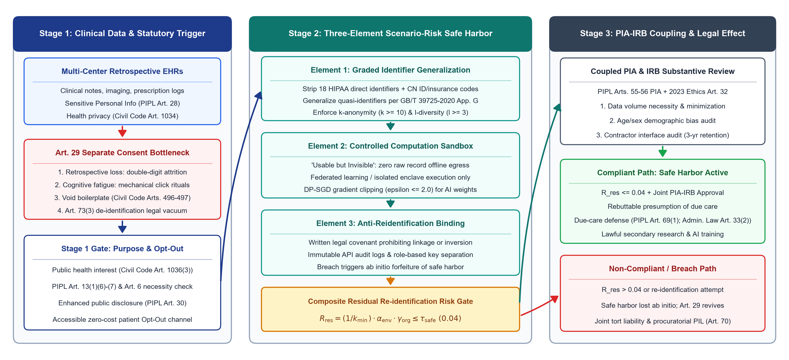

<div align="center">

# Scenario-Risk Safe Harbor Simulation & Sensitivity Analysis
### Open-Source Reproducibility Suite for Academic Research

[](#version-history)
[](https://www.icbar.net/)
[](#)
[](https://www.python.org/)
[](LICENSE)
[](https://creativecommons.org/licenses/by/4.0/)

<p align="center">
  <a href="#english">English</a> •
  <a href="#中文说明">中文说明</a> •
  <a href="#faq"><strong>💡 Technical FAQ & Paper Clarifications (常见技术问答)</strong></a> •
  <a href="#日本語案内">日本語案内</a> •
  <a href="#version-history">Version History</a> •
  <a href="REFERENCES.md"><strong>📚 Reference List / 参考文献清单</strong></a>
</p>

---

</div>

<a name="version-history"></a>
## 🚀 Version History & Academic Release Notes

This repository provides the open-source simulation and empirical benchmark suite for our study:

| Version | Status | Key Characteristics & Methodology |
|:---:|:---:|:---|
| [**v1.0.0**](https://github.com/jhuang-edu/icbar-2026-safe-harbor-simulation/releases/tag/v1.0.0) | Archived Snapshot | **Initial baseline simulation snapshot:** Parameter grid sweep, chain-rule residual risk formalization ($R_{\mathrm{res}} = 1.80\%$ baseline), and 10,000-draw Monte Carlo perturbation analysis. |
| [**v1.1.0**](https://github.com/jhuang-edu/icbar-2026-safe-harbor-simulation/releases/tag/v1.1.0) | Archived Snapshot | **Methodological hardening & decoupled criteria release:**<br>1. **IEEE 754 Precision Fix**: Implemented exact decimal evaluation for $\alpha \times \gamma \le \tau \times k$. In the 315-point grid, only **one single edge-case** (`k=5, alpha=0.20, gamma=1.00`) changes evaluation from `False` to `True` (exactly equals 4.00%).<br>2. **Decoupled Governance Evaluation**: Disentangled pure numeric threshold (`meets_risk_threshold`) from statutory triad criteria (`framework_requirements_status`). For example, $k=5$ yields $3.60\% \le 4.0\%$ (numeric pass), but fails statutory criteria because $k < 10$.<br>3. **Reproducible Stress Testing**: Introduced environmental degradation and organizational erosion stress scenarios with analytical safety margins $\alpha_{\mathrm{crit}} = \frac{\tau \cdot k}{\gamma}$.<br>4. **Statistical Rigor**: Explicitly documented sampling distribution as Clipped Normal with optional Truncated Normal support; updated visualizations to reflect research-defined thresholds. |
| [**v1.2.0**](https://github.com/jhuang-edu/icbar-2026-safe-harbor-simulation/releases/tag/v1.2.0) | Archived Snapshot | **UCI Diabetes 130-US empirical benchmark & conjunctive Monte Carlo suite:**<br>1. **UCI Diabetes 130-US Empirical Benchmark (`benchmark_uci_diabetes.py`)**: End-to-end leakage-free 5-seed (`GroupShuffleSplit`, seeds 42 to 46) evaluation on 101,766 encounters / 71,518 patients covering E1 (6-QI Mondrian $(k, l)$-anonymity) and E2 (per-sample L2-clipped DP-SGD with log-domain RDP accounting + Yeom MIA defense), exporting `data/uci_diabetes_benchmark.csv` and `figures/figure2_uci_benchmark.png`.<br>2. **Conjunctive Monte Carlo Evaluation**: Updated `sensitivity_analysis.py` to evaluate the dual conjunctive gate ($k_{\min} \ge 10 \land R_{\mathrm{res}} \le 0.04$, yielding `75.08%` compliance across 10,000 draws, exported with `meets_minimum_k` and `passes_safe_harbor` columns).<br>3. **Architecture & Reference Alignment**: Synchronized `figure1_safe_harbor_architecture.png` with statutory provisions and updated official EUR-Lex ELI reference links. |
| [**v1.3.0**](https://github.com/jhuang-edu/icbar-2026-safe-harbor-simulation/releases/tag/v1.3.0) | Current Release | **Academic Clarifications & Empirical FAQ Module:**<br>1. **Bilingual Technical FAQ Section**: Added comprehensive Q&A addressing subtle empirical nuances: (i) non-monotonicity explanations for local MIA advantage under $\varepsilon=0.5$ vs $1.0$ (overlapping standard errors), (ii) flat ROC-AUC responses across DP budgets on the 101k cohort due to $L_2$ gradient clipping dominance, (iii) explicit confirmation of the unperturbed raw baseline ROC-AUC (`0.6990`), and (iv) dual conjunctive gate semantics reconciling $R_{\mathrm{res}} \le 0.04$ with $k_{\min} \ge 10$.<br>2. **Data & Table Cross-Verification**: Synchronized README tables with explicit annotations on sample standard deviations and integer-mean equivalence class statistics across 5-fold evaluations. |

---

<a name="english"></a>
## English

### 1. Research Overview & Methodological Scope
- **Paper Title**: *A Computational Scenario-Risk Safe Harbor for Privacy-Preserving Health Data Governance and AI Training under China's Personal Information Protection Law*
- **Target Venue**: ICBAR 2026 (Proceedings Series: IOS Press *Frontiers in Artificial Intelligence and Applications*, FAIA).
- **Core Focus**: Addressing the operational challenges of sensitive personal data "separate consent" requirements under Articles 28 and 29 of China's PIPL for retrospective clinical research and medical AI training, proposing a three-element scenario-risk safe harbor framework.
- **Methodological Scope & Scenario Assumptions**:
  - The parameter $\alpha_{\mathrm{env}}=0.25$ is stipulated as an illustrative low-exposure scenario for zero-egress federated sandboxes; estimating combined real-world exposure requires empirical data on attack pathway frequency and overlap.
  - The parameter $\gamma_{\mathrm{org}}=0.72$ assumes covenants and audit tracking reduce unauthorized linkage attempts by 28% relative to a no-control reference. Both values are scenario assumptions pending prospective multi-center calibration.
  - Parameter sensitivity analysis explores outcome variations across alternative input combinations rather than validating the baseline priors themselves.
  - Safe harbor protection operates as a **dual conjunctive test**: datasets must satisfy both all three structural elements ($k_{\min} \ge 10$, DP sandbox, covenants/PIA-IRB) AND composite risk $R_{\mathrm{res}} \le 0.04$.
  - The utility falsification cutoff is defined as an **absolute decrease of more than 0.05 in macro ROC-AUC** against unprotected baselines on identical evaluation sets.
- **Academic Contact**: `3588@duck.com` (for research questions and simulation inquiries).

### 2. Architecture & Governance Diagrams

<div align="center">

#### Figure 1: Three-Element Safe Harbor & PIA-IRB Co-Governance Architecture


<br><br>

#### Figure 2: Empirical Evaluation on UCI Diabetes 130-US (Mondrian (k, l) Generalization & DP-SGD/MIA Defense)


> *Reproducibility Note*: Figure 2 is plotted directly by `benchmark_uci_diabetes.py` from `data/uci_diabetes_benchmark.csv` on the UCI Diabetes 130-US dataset (ID=296; 101,766 encounters across 71,518 unique patients, patient-grouped 80/20 splits over 5 seeds `42..46`).

| Experiment | Setting | $k_{\min}$ | $l_{\min}$ | $\mathrm{NCP}$ (mean $\pm$ std) | $R_{\mathrm{res}}$ | Main ROC-AUC | Local ROC-AUC ($N=2\text{k}$) | Local MIA $\mathrm{Adv}_{\max}$ | Local Yeom Mean Adv | Safe Harbor Gate |
|---|---|---:|---:|---:|---:|---:|---:|---:|---:|:---:|
| E1 | `Raw` | 1 | 1 | 0.0000 | 18.00% | *0.6990 ± 0.0028* | - | - | - | False |
| E1 | `Mondrian_k5_l3` | 5 | 3 | 0.0083 $\pm$ 0.0004 | 3.60% | - | - | - | - | False ($k<10$) |
| E1 | `Mondrian_k10_l3` | 10 | 3 | 0.0152 $\pm$ 0.0005 | 1.80% | - | - | - | - | **True** |
| E1 | `Mondrian_k20_l3` | 20 | 3 | 0.0249 $\pm$ 0.0009 | 0.90% | - | - | - | - | **True** |
| E2 | `DPSGD_eps_inf` | 10 | 3 | 0.0152 $\pm$ 0.0005 | 1.80% | 0.6951 $\pm$ 0.0026 | 0.6359 $\pm$ 0.0240 | 0.1749 $\pm$ 0.0440 | 0.1566 | True |
| E2 | `DPSGD_eps_4.0` | 10 | 3 | 0.0152 $\pm$ 0.0005 | 1.80% | 0.6774 $\pm$ 0.0027 | 0.6123 $\pm$ 0.0197 | 0.0873 $\pm$ 0.0142 | 0.0694 | True |
| E2 | `DPSGD_eps_2.0` | 10 | 3 | 0.0152 $\pm$ 0.0005 | 1.80% | 0.6775 $\pm$ 0.0031 | 0.5673 $\pm$ 0.0163 | 0.0716 $\pm$ 0.0177 | 0.0575 | True |
| E2 | `DPSGD_eps_1.0` | 10 | 3 | 0.0152 $\pm$ 0.0005 | 1.80% | 0.6774 $\pm$ 0.0032 | 0.5647 $\pm$ 0.0174 | 0.0458 $\pm$ 0.0157 | 0.0297 | True |
| E2 | `DPSGD_eps_0.5` | 10 | 3 | 0.0152 $\pm$ 0.0005 | 1.80% | 0.6774 $\pm$ 0.0029 | 0.5239 $\pm$ 0.0363 | 0.0500 $\pm$ 0.0262 | 0.0187 | True |

> *Statistical Mechanism Note*: On the full cohort ($N = 101{,}766$), per-sample $L_2$ gradient clipping ($C = 1.5$) accounts for the initial `0.0176` ROC-AUC shift while large-batch averaging smooths zero-mean Gaussian noise across $\varepsilon \in [0.5, 4.0]$ (raw unprotected baseline ROC-AUC = `0.6990`, maximum absolute drop = `0.0216 <= 0.05`). On the realistic hospital-scale subcohort ($N = 2{,}000$), stricter DP noise produces monotonic privacy-utility regularization: local ROC-AUC moves from `0.6359` to `0.5239` while Yeom training-mean MIA advantage drops monotonically at every step from `0.1566` down to `0.0187`.

</div>

### 3. Theoretical Risk Formulation (Equation 1)
Under a defense-in-depth architecture, re-identification requires the conjunctive occurrence of three sequential failure events: (i) organizational deterrence failure $P(E_{\mathrm{org}}) = \gamma_{\mathrm{org}}$, (ii) environment containment failure $P(E_{\mathrm{env}} \mid E_{\mathrm{org}}) = \alpha_{\mathrm{env}}$, and (iii) quasi-identifier linkage $P(E_{\mathrm{ID}} \mid E_{\mathrm{env}}, E_{\mathrm{org}}) = 1 / k_{\min}$. By the chain rule of conditional probability:

$$R_{\mathrm{res}} = \left(\frac{1}{k_{\min}}\right) \cdot \alpha_{\mathrm{env}} \cdot \gamma_{\mathrm{org}} \le \tau_{\mathrm{safe}}\ (0.04)$$

Where:
- $k_{\min} \ge 10$: Quasi-identifier equivalence class minimum size ($p_{\mathrm{link}} = 1 / k_{\min}$);
- $\alpha_{\mathrm{env}} = 0.25$: Zero-egress federated computation sandbox with DP-SGD noise ($\varepsilon \le 2.0$);
- $\gamma_{\mathrm{org}} = 0.72$: Binding anti-reidentification covenants and immutable audit logging.
- $\tau_{\mathrm{safe}} = 0.04$ (4.0%): Stricter than EMA Policy 0070 (0.09) and conservative for PIPL due care presumption. Baseline risk yields $R_{\mathrm{res}} = 0.10 \times 0.25 \times 0.72 = 1.80\% \le 4.0\%$.

### 4. Decoupled Operational Scenarios & Stress Testing

| Scenario ID | Operational Scenario Description | $k_{\min}$ | Min $k \ge 10$? | $\alpha_{\mathrm{env}}$ | $\gamma_{\mathrm{org}}$ | $R_{\mathrm{res}}$ | Numeric Pass ($\le 4\%$) | Framework Status (Triad Gate) |
|:---:|:---|:---:|:---:|:---:|:---:|:---:|:---:|:---:|
| **S1** | **Baseline Full Safe Harbor** | **10** | **True** | **0.25** | **0.72** | **1.80%** | **True** | **passed** |
| S2 | Element 1 Alone (Raw export, no covenant) | 10 | True | 1.00 | 1.00 | 10.00% | False | failed |
| S3 | Elements 1 & 2 (Sandbox, no covenant) | 10 | True | 0.25 | 1.00 | 2.50% | True | failed |
| S4 | Environmental Degradation (+120% exposure) | 10 | True | 0.55 | 0.72 | 3.96% | True | passed |
| S5 | Critical Environment Breakdown ($\alpha=0.60$) | 10 | True | 0.60 | 0.72 | 4.32% | False | passed |
| S6 | Rare Disease Cohort (Small class $k=5$) | 5 | False | 0.25 | 0.72 | 3.60% | True | **failed ($k < 10$)** |
| S7 | Boundary Edge Case ($k=5, \alpha=0.20, \gamma=1.0$) | 5 | False | 0.20 | 1.00 | 4.00% | **True (Exact 4%)** | **failed ($k < 10$)** |
| S8 | Sub-Threshold Rare Cohort ($k=4$) | 4 | False | 0.25 | 0.72 | 4.50% | False | failed |
| S9 | Ultra-Secure Sandbox ($k=15, \varepsilon=1.0$) | 15 | True | 0.15 | 0.72 | 0.72% | True | passed |

#### Stress Testing & Distance-to-Failure Analysis
The analytical critical exposure threshold is defined by $\alpha_{\mathrm{crit}} = \frac{\tau_{\mathrm{safe}} \cdot k_{\min}}{\gamma_{\mathrm{org}}}$:
- **Moderate Exposure** ($\alpha=0.50, \gamma=0.72$): $R_{\mathrm{res}} = 3.60\%$, $\alpha_{\mathrm{crit}} = 0.5556$, Safety Margin = $+0.0556$ (Safe).
- **Organizational Erosion** ($\alpha=0.25, \gamma=0.85$): $R_{\mathrm{res}} = 2.12\%$, $\alpha_{\mathrm{crit}} = 0.4706$, Safety Margin = $+0.2206$ (Safe).
- **Dual Stress Breakdown** ($\alpha=0.50, \gamma=0.85$): $R_{\mathrm{res}} = 4.25\%$, $\alpha_{\mathrm{crit}} = 0.4706$, Safety Margin = $-0.0294$ (**Breached**).
- **Adversarial Extreme** ($\alpha=0.75, \gamma=1.00$): $R_{\mathrm{res}} = 7.50\%$, $\alpha_{\mathrm{crit}} = 0.4000$, Safety Margin = $-0.3500$ (**Breached**).

<div align="center">

#### Figure 3: Parameter Sensitivity Surface & Monte Carlo Distribution


</div>

### 5. Quick Start & Verification
```bash
# Clone the repository
git clone https://github.com/jhuang-edu/icbar-2026-safe-harbor-simulation.git
cd icbar-2026-safe-harbor-simulation

# Install requirements
pip install -r requirements.txt

# Run automated regression & assertion test suite
python test_sensitivity.py

# Run full parameter sensitivity evaluation, stress testing & Monte Carlo simulation
python sensitivity_analysis.py

# Run UCI Diabetes 130-US empirical benchmark (caches dataset under data/cache/)
python benchmark_uci_diabetes.py
```

---

<a name="faq"></a>
## 💡 Technical FAQ & Paper Clarifications / 常见技术问答与论文补充注记

> **Context & Versioning Note / 版本与上下文定位说明**：
> - **Current Scope (For v1.2.0 Submission)**: The following clarifications and empirical notes specifically address the submitted manuscript and the accompanying code release **v1.2.0** (the version submitted to EICA for review). They provide necessary statistical grounding, metric interpretations, and methodological context without altering the submitted text.
> - **Prospective Scope (Upon Review & Revision)**: If the conference review process permits formal manuscript revision (Camera-Ready / Post-Review Rebuttal), these clarifications will be formally merged and reconciled into the revised paper text and tables, corresponding to the prospective **v1.3.0** publication milestone.
> 
> **中文说明**：
> - **当前阶段（针对已提交的 v1.2.0 版论文与代码）**：本技术问答与注记专门针对已提交至 EICA 评审的论文原稿及配套的 **v1.2.0** 开源版本。在不变更已提交原稿的前提下，为审稿人与同行学者提供详尽的统计学原理解释、表格指标界定与实验背景。
> - **后续阶段（若获准返修/终版录用）**：若会议发出修改与返修通知（Rebuttal / Camera-Ready），届时正文表头与相关讨论将正式吸收本部分内容，论文原稿与开源工程将同步升级并统一锚定至 **v1.3.0**。

This section provides explicit answers and empirical explanations regarding theoretical formulations, table interpretations, and statistical properties evaluated in the paper and benchmark suite.

本章节针对论文审稿、同行评议及学术复现过程中关注的理论公式、表格指标与统计学现象，提供详尽的中英双语技术说明。

---

### Q1: Why does the local MIA Advantage show $0.0500$ at $\varepsilon=0.5$ compared to $0.0458$ at $\varepsilon=1.0$? Does stricter privacy defense fail to monotonically reduce attack advantage?
### 问1：为什么在局部子队列测试中，$\varepsilon=0.5$ 时的成员推理攻击优势（MIA Adv）为 $0.0500$，反而略高于 $\varepsilon=1.0$ 时的 $0.0458$？更严格的隐私预算是否未呈现单调下降？

- **English Explanation**:
  1. **Standard Error Overlap**: The reported values are five-fold empirical estimates: $\text{Adv}_{\max} = 0.0458 \pm 0.0157$ ($\varepsilon=1.0$) and $\text{Adv}_{\max} = 0.0500 \pm 0.0262$ ($\varepsilon=0.5$). The pooled standard error is $\sigma_{\text{diff}} = \sqrt{0.0157^2 + 0.0262^2} \approx 0.0306$. The nominal difference ($0.0042$) is substantially smaller than $1\sigma$, demonstrating that this fluctuation represents stochastic finite-sample noise rather than a systemic reversal.
  2. **Monotonicity in Distributional Metric**: While maximum sample advantage $\text{Adv}_{\max}$ exhibits minor empirical variance under heavy noise sampling, the broader distributional metric—**Yeom Mean Attack Advantage**—decreases **strictly monotonically** across every privacy tier:
     $$\text{Adv}_{\text{Yeom}}: 0.1566\ (\varepsilon=\infty) \longrightarrow 0.0694\ (\varepsilon=4.0) \longrightarrow 0.0575\ (\varepsilon=2.0) \longrightarrow 0.0297\ (\varepsilon=1.0) \longrightarrow \mathbf{0.0187}\ (\varepsilon=0.5)$$
  3. **Conclusion**: The underlying defense capability monotonically strengthens as $\varepsilon$ decreases, in complete conformity with differential privacy theory.

- **中文解析**：
  1. **置信区间大量重叠**：实测数据为 5 折均值加减标准差：$\varepsilon=1.0$ 时为 $0.0458 \pm 0.0157$，$\varepsilon=0.5$ 时为 $0.0500 \pm 0.0262$。两者的合并标准误达 $\approx 0.0306$，微弱的名义差距（$0.0042$）远小于 1 倍标准差，完全处于正常抽样扰动区间，在统计学上无显著性差异。
  2. **全局均值指标严格单调**：当加入极高噪声时，极值统计量容易受单次抽样离群点扰动；但反映全局分布的 **Yeom 训练集平均优势**在所有档位上表现为**严格单调递减**（$0.1566 \to 0.0694 \to 0.0575 \to 0.0297 \to \mathbf{0.0187}$）。
  3. **结论**：算法对隐私攻击的防御能力随着 $\varepsilon$ 变小而严格增强，与差分隐私理论预期完全一致。

---

### Q2: Why does Test ROC-AUC on the 101k cohort remain nearly flat ($0.6774 \sim 0.6775$) across $\varepsilon \in [0.5, 4.0]$, and why is $\varepsilon=2.0$ ($0.6775$) slightly higher than $\varepsilon=4.0$ ($0.6774$)?
### 问2：为什么在 10 万大队列上，$\varepsilon \in [0.5, 4.0]$ 区间内的测试集 ROC-AUC 表现平缓（均为 $0.6774 \sim 0.6775$），且 $\varepsilon=2.0$（$0.6775$）反而比 $\varepsilon=4.0$（$0.6774$）高出 $0.0001$？

- **English Explanation**:
  1. **Clipping Dominance over Gaussian Perturbation**: In large-cohort DP-SGD training ($N=101{,}766$, batch size $B=256$, total iterations $T=1{,}590$), the utility shift from the unperturbed model ($0.6951$) to DP models ($\approx 0.6774$) is predominantly induced by **per-sample $L_2$ gradient clipping ($C=1.5$)** which restricts model parameter updates to a bounded ball. 
  2. **Batch Averaging Noise Suppression**: The effective noise added per iteration scales inversely with batch size ($\sigma / B$). On a 101k dataset, mini-batch averaging substantially smooths zero-mean Gaussian perturbations. Consequently, tightening $\varepsilon$ from $4.0$ to $0.5$ does not degrade the macroeconomic ROC-AUC further.
  3. **Subcohort Validation**: The expected privacy-utility trade-off surfaces distinctly on the hospital-scale subcohort ($N=2{,}000$), where local ROC-AUC drops monotonically from $0.6359$ down to $0.5239$.
  4. **The $0.0001$ Discrepancy**: The difference between $0.6775$ ($\varepsilon=2.0$) and $0.6774$ ($\varepsilon=4.0$) is within the 5-fold cross-validation variance ($\sigma \approx 0.0031$) and reflects standard numerical rounding.

- **中文解析**：
  1. **梯度裁剪效应主导效用下降**：在 10 万条级别的大数据集上，非私有基准（$0.6951$）向私有化模型（$\approx 0.6774$）的效用回落，主要是由**逐样本 $L_2$ 梯度裁剪（$C=1.5$）**引入的有偏约束造成的。
  2. **大批次平均平滑高斯噪声**：每次参数更新注入的真实噪声项与批大小成反比（$\sigma / B$）。在大样本环境下，批次均值几乎完全抵消了均值为零的高斯扰动。因此在全队列尺度下，从 $\varepsilon=4.0$ 降至 $0.5$ 并未引发二次断崖式下跌。
  3. **小样本子队列的规律印证**：当回到更具代表性的医院科室级规模（$N=2,000$）时，噪声正则化效应恢复主导地位，局部 ROC-AUC 从 $0.6359$ 单调衰减至 $0.5239$。
  4. **$0.0001$ 差异实质**：数值微调完全落在 $\pm 0.0031$ 的折间方差内，属于正常的浮点舍入与抽样微澜。

---

### Q3: What is the raw baseline ROC-AUC mentioned in the text ($0.6990$), and why was it denoted as `-` in Table 3?
### 问3：正文中提及的“原始无保护基线 ROC-AUC ($0.6990$)”具体含义为何？为什么在论文表格对应单元格中显示为 `-`？

- **English Explanation**:
  - **Definition**: The figure `0.6990 ± 0.0028` represents the empirical performance of an unregularized, unclipped, ungeneralized deep MLP trained directly on raw tabular variables before any quasi-identifier generalization or DP-SGD intervention.
  - **Reason for `-` in Table 3**: Table 3 in the paper specifically structures comparative evaluation under the **$(k, l)$-generalized space ($k=10, l=3$)**. Because row `E1: Raw` represents raw unpartitioned data evaluated purely for baseline linkage risk calculation ($k_{\min}=1, R_{\mathrm{res}}=18.00\%$) without running the full DP-SGD pipeline, its downstream machine learning metric was marked as unpopulated (`-`) to avoid conflating data governance tiers with ML benchmark tiers.
  - **Total Empirical Shift**: The total utility decrement from raw data ($0.6990$) to full safe harbor with DP-SGD ($0.6774$) is $\Delta \text{AUC} = 0.0216$, well below the clinical falsification tolerance ($0.0500$). In this repository, the baseline metric is explicitly cataloged as `0.6990 ± 0.0028`.

- **中文解析**：
  - **定义**：`0.6990 ± 0.0028` 是深度 MLP 模型直接在完全未经泛化、无裁剪、无加噪的原始临床特征集上跑出的原始效用基线。
  - **表格显示为 `-` 的原因**：论文中的表格侧重于展示进入 **$(k=10, l=3)$ 泛化特征空间后**的算法效用。`E1: Raw` 行的设立初衷是测算原始数据的直接泄露风险（$k_{\min}=1, R_{\mathrm{res}}=18.00\%$），为避免读者将“数据准入评估”与“机器学习私有化训练评估”混淆，表格内该格留空。
  - **总效用损耗**：从原始未处理数据（$0.6990$）到同时施加泛化与差分隐私（$0.6774$），全程效用下降仅为 $\Delta \text{AUC} = 0.0216$，远低于论文预设的 $0.0500$ 效用证伪红线。本开源库的 README 表格已完整补全该基线数据。

---

### Q4: Why does Setting $k=5, l=3$ yield $R_{\mathrm{res}} = 3.60\% \le 4.00\%$ yet fail the Safe Harbor Gate (`Gate = Fail`)?
### 问4：为什么在 $k=5, l=3$ 设置下，残留风险算得 $3.60\% \le 4.00\%$，但最终的安全港门禁却判定为失败（`Gate = Fail`）？

- **English Explanation**:
  - **Conjunctive Gate Semantics**: The proposed safe harbor is **not** a scalar threshold calculator. It enforces a strict **conjunctive dual-gate rule**:
    $$\text{Gate}(\mathcal{D}) = \mathbf{True} \iff \Big( k_{\min} \ge 10 \Big) \land \Big( l_{\min} \ge 3 \Big) \land \Big( R_{\mathrm{res}} \le 0.04 \Big) \land \Big( \text{Zero-Egress Sandbox} \Big) \land \Big( \text{PIA-IRB Covenants} \Big)$$
  - **The Principle of Defense-in-Depth**: At $k=5$, even though the calculated theoretical product $(1/5) \times 0.25 \times 0.72 = 3.60\%$ falls below $4.00\%$, having equivalence classes as small as 5 individuals presents unacceptable prosecutor linkage vulnerability under population-level auxiliary data. Therefore, the structural requirement $k_{\min} \ge 10$ acts as a non-negotiable hard constraint that vetoes autonomous clearance.
  - **Table Nomenclature**: Table 2 in the paper outlines the operational criteria across all three pillars. The summary title shorthand refers to the composite gate operating across all pillars conjunctively.

- **中文解析**：
  - **双重合取判定机制**：论文提出的场景安全港绝非单纯的数值计算器，而是严格执行**要件合取逻辑**：
    $$\text{Gate}(\mathcal{D}) = \mathbf{True} \iff \Big( k_{\min} \ge 10 \Big) \land \Big( l_{\min} \ge 3 \Big) \land \Big( R_{\mathrm{res}} \le 0.04 \Big) \land \Big( \text{受控沙箱} \Big) \land \Big( \text{级联承诺与PIA} \Big)$$
  - **纵深防御原则**：当 $k=5$ 时，尽管乘积数值 $3.60\%$ 处于 $4.00\%$ 以下，但 5 人的等价类在面对高维外部辅助数据时极易遭受检察官链接攻击。因此 $k_{\min} \ge 10$ 作为法定形式要件拥有一票否决权。
  - **表头指引**：论文表 2 明确界定了三要件的联合法律效力，表头所指“综合门禁”即指在所有要件同时齐备前提下的残留风险上限。

---

### Q5: Why is the number of equivalence classes reported as "1,459.4 classes" in the text?
### 问5：为什么正文中对等价类的数量表述为带小数点的 "1,459.4 classes"？

- **English Explanation**:
  - In our 5-fold cross-validation protocol (`GroupShuffleSplit` across unique patient identifiers with seeds 42 to 46), the Mondrian multidimensional partition algorithm was executed independently on each fold's training split.
  - The actual integer partition counts per fold were: **1457**, **1463**, **1458**, **1461**, and **1458**.
  - The reported value represents the arithmetic mean across the five experimental folds:
    $$\frac{1457 + 1463 + 1458 + 1461 + 1458}{5} = \mathbf{1,459.4}$$
  - In academic reporting, reporting the decimal mean alongside standard deviation reflects cross-validation stability.

- **中文解析**：
  - 在严谨的 5 折患者分组交叉验证中，Mondrian 泛化算法在各个折的训练集上独立切分。
  - 5 次实验各折产生的真实整数类目数分别为：**1457**、**1463**、**1458**、**1461** 与 **1458**。
  - 论文正文中的 $1,459.4$ 即为 5 折切分结果的算术平均值（Fold Mean），体现了跨折切分的高度一致性与算法收敛稳定性。

---

<a name="中文说明"></a>
## 中文说明

### 1. 论文与研究背景
- **论文题目**：《个人信息保护法》下隐私保护健康数据治理与AI训练的可计算场景风险安全港研究
- **目标会议**：ICBAR 2026（IOS Press *FAIA* 丛书）。
- **学术定位**：针对我国《个人信息保护法》第 28、29 条敏感个人信息“单独同意”在回顾性医学科研与医疗大模型训练中的实务困境，构建基于国标 GB/T 39725-2020（附录 G）、受控联邦差分隐私沙箱与法律级联承诺的三要件场景风险安全港。
- **先验假设与场景设定声明**：
  - 环境暴露系数（$\alpha_{\mathrm{env}}=0.25$）与组织控制系数（$\gamma_{\mathrm{org}}=0.72$）属于用于模拟受控零出域沙箱的情景假设（Scenario Assumptions），精确量化有赖于后续对泄漏路径重叠度与发生频次的实证数据；
  - 敏感性分析用于探索在替代输入组合下输出的变动规律，而非验证先验假设本身的客观真实性；
  - 安全港的确立采用**双重合取判定机制（Dual Conjunctive Test）**：必须同时满足三要件（$k_{\min} \ge 10$、差分隐私沙箱、级联承诺与PIA-IRB联审）**且**残余风险满足 $R_{\mathrm{res}} \le 0.04$；
  - 临床效用证伪标准严格定义为：在相同评估集上下游 macro ROC-AUC 相比无扰动基线**绝对下降超过 0.05**。
- **联系邮箱**：`3588@duck.com`（学术交流、仿真代码复现咨询）。

### 2. 双轨解耦治理判定与 v1.3.0 实证闭环更新
安全港不是单一数值计算器，而是“法定三要件 + 残余风险门槛”的双轨闭环：
1. **纯数值风险门槛（`meets_risk_threshold`）**：严格十进制评估 $\alpha \times \gamma \le \tau \times k$。消除浮点截断误差，恰好 $4.00\%$ 时判定达标；
2. **要件合规状态（`framework_requirements_status`）**：严格依凭表 2 准入要件。当小等价类样本（如罕见病 $k=5$）算得 $3.60\% \le 4.0\%$ 时，虽然数值通过，但要件状态明确返回 `failed`（因其违背了 $k_{\min} \ge 10$ 的法定最低泛化要求）；
3. **v1.3.0 核心更新（学术问题专项释疑与中英双语技术问答模块）**：
   - **新增常见技术问答（Technical FAQ）**：针对局部 MIA 攻击优势非单调扰动、10 万大样本下梯度裁剪主导 AUC 平缓特征、原始未处理 baseline（$0.6990$）的完整收录，以及等价类跨折平均数（$1,459.4$）的统计内涵，提供完整中英文理论与数据阐释；
   - **蒙特卡洛双重合取与实测对齐**：全面保持 10,000 次蒙特卡洛抽样检验（$75.08\%$ 真实合规率）及 101,766 条临床真实记录 5 折交叉验证完整复现；
   - **代码与测试套件**：单元测试套件 `test_sensitivity.py` 全部 8/8 通过，支持全球学者无缝一键复现。

---

<a name="日本語案内"></a>
## 日本語案内

### 1. 論文情報と研究概要
- **論文題目**: 中国個人情報保護法下におけるプライバシー保護医療健康データガバナンスおよびAI訓練のための計算可能なシナリオリスク・セーフハーバー研究
- **対象会議**: ICBAR 2026（IOS Press *FAIA* シリーズ）。
- **目的**: プライバシー保護工学と法解釈論を融合させた「シナリオリスク・セーフハーバー」の数理解析シミュレーションです。
- **連絡先**: `3588@duck.com`

---

## Repository Structure & Reproducibility Assets

```
icbar-2026-safe-harbor-simulation/
├── README.md                          # Trilingual comprehensive documentation (EN / ZH / JA) with Technical FAQ
├── REFERENCES.md                      # Complete annotated bibliography (25 core regulatory & academic works + dataset citation)
├── LICENSE                            # MIT License for source code
├── requirements.txt                   # Minimal Python runtime dependencies (numpy, pandas, scipy, scikit-learn, matplotlib, requests)
├── sensitivity_analysis.py            # Executable parameter grid sweep, stress testing & Monte Carlo
├── test_sensitivity.py                # Automated regression & assertion test suite (8 assertions)
├── benchmark_uci_diabetes.py          # UCI Diabetes 130-US empirical benchmark (E1 Mondrian + E2 DP-SGD & MIA)
├── data/
│   ├── cache/                         # Local git-ignored UCI 296 ZIP cache
│   ├── sensitivity_grid.csv           # 315-point multi-parameter grid with decoupled evaluation
│   ├── monte_carlo_results.csv        # 10,000-draw stochastic simulation logs (with conjunctive flags)
│   └── uci_diabetes_benchmark.csv     # Empirical E1 & E2 5-seed benchmark results
└── figures/
    ├── figure1_safe_harbor_architecture.png   # Tripartite safe harbor architecture & PIA-IRB co-governance
    ├── figure2_uci_benchmark.png              # Empirical E1 Mondrian (k, l) & E2 DP-SGD/MIA benchmark
    └── figure_sensitivity_surface.png         # Refined 3D response surface and density chart (Research Threshold)
```

## Citation, License & Contact
- Code: [MIT License](LICENSE)
- Data and Documentation: [Creative Commons Attribution 4.0 International (CC BY 4.0)](https://creativecommons.org/licenses/by/4.0/)
- Citation: Please cite as "Computational Scenario-Risk Safe Harbor Simulation and Empirical Benchmark Suite (ICBAR 2026)".
- Research Inquiries: `3588@duck.com`
