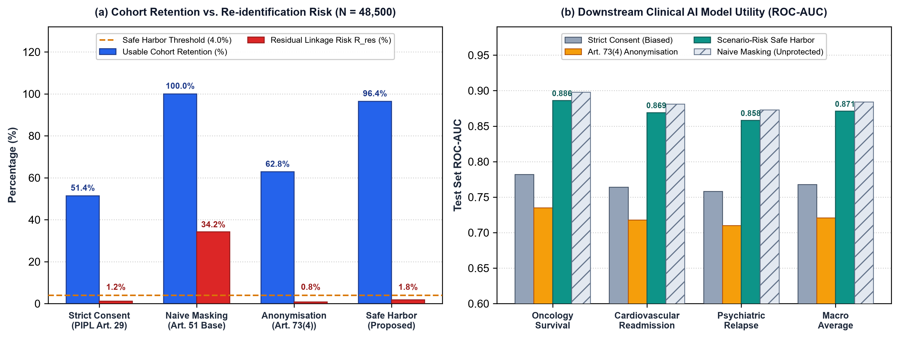

<div align="center">

# Scenario-Risk Safe Harbor Simulation & Sensitivity Analysis
### Open-Source Reproducibility Suite for Academic Research

[](https://www.ais.cn/attendees/index/2ER6F3)
[](#)
[](https://www.python.org/)
[](LICENSE)
[](https://creativecommons.org/licenses/by/4.0/)

<p align="center">
  <a href="#english">English</a> •
  <a href="#中文说明">中文说明</a> •
  <a href="#日本語案内">日本語案内</a> •
  <a href="REFERENCES.md"><strong>📚 Reference List / 参考文献清单</strong></a>
</p>

---

</div>

<a name="english"></a>
## English

### 1. Research Overview & Paper Status
- **Paper Title**: *Scenario-Risk Safe Harbor for Secondary Health Data Governance and AI Training under China's Personal Information Protection Law*
- **Current Status**: Under Revision / Peer Review (Target Venue: ICBAR 2026, proceedings scheduled with IOS Press *FAIA*).
- **Core Focus**: Addressing the operational challenges of sensitive personal data "separate consent" requirements under Articles 28 and 29 of China's PIPL for retrospective clinical research and medical AI training, proposing a three-element scenario-risk safe harbor framework.
- **Academic Contact**: `3588@duck.com` (for research questions and simulation inquiries).

### 2. Architecture & Governance Diagrams

<div align="center">

#### Figure 1: Three-Element Safe Harbor & PIA-IRB Co-Governance Architecture


<br><br>

#### Figure 2: Four-Phase Governance Evaluation & Dynamic Evolution


</div>

### 3. Theoretical Risk Formulation (Equation 1)
Under a defense-in-depth architecture, re-identification requires the conjunctive occurrence of three sequential failure events: (i) organizational deterrence failure $P(E_{\mathrm{org}}) = \gamma_{\mathrm{org}}$, (ii) environment containment failure $P(E_{\mathrm{env}} \mid E_{\mathrm{org}}) = \alpha_{\mathrm{env}}$, and (iii) quasi-identifier linkage $P(E_{\mathrm{ID}} \mid E_{\mathrm{env}}, E_{\mathrm{org}}) = 1 / k_{\min}$. By the chain rule of conditional probability:

$$R_{\mathrm{res}} = \left(\frac{1}{k_{\min}}\right) \cdot \alpha_{\mathrm{env}} \cdot \gamma_{\mathrm{org}} \le \tau_{\mathrm{safe}}\ (0.04)$$

Where:
- $k_{\min} \ge 10$: Quasi-identifier equivalence class minimum size ($p_{\mathrm{link}} = 1 / k_{\min}$);
- $\alpha_{\mathrm{env}} = 0.25$: Zero-egress federated computation sandbox with DP-SGD noise ($\varepsilon \le 2.0$);
- $\gamma_{\mathrm{org}} = 0.72$: Binding anti-reidentification covenants and immutable audit logging.
- $\tau_{\mathrm{safe}} = 0.04$ (4.0%): Stricter than EMA Policy 0070 (0.09) and HIPAA Expert Determination (0.05). Baseline risk yields $R_{\mathrm{res}} = 0.10 \times 0.25 \times 0.72 = 1.80\% \le 4.0\%$.

### 4. Falsification Criteria & Governance Thresholds
To prevent unfalsifiable safe harbors, three rigorous falsification conditions are formalized:
1. **Utility Degradation Ceiling**: Safe harbor parameters are falsified if DP-SGD noise causes $> 5\%$ macro ROC-AUC loss compared to unperturbed models on clinical benchmarks.
2. **Administrative Efficiency**: Institutional IRB/PIA review must conclude within 30 calendar days or 40 compliance person-hours per protocol.
3. **Re-identification Verification**: Any successful linkage under adversarial conditions immediately invalidates the baseline presumption.

### 4. Key Sensitivity Scenarios

| Scenario ID | Operational Scenario Description | $k_{\min}$ | $\alpha_{\mathrm{env}}$ | $\gamma_{\mathrm{org}}$ | $R_{\mathrm{res}}$ | Gate Status ($\tau_{\mathrm{safe}} \le 4\%$) |
|:---:|:---|:---:|:---:|:---:|:---:|:---:|
| **S1** | **Baseline Full Safe Harbor** | **10** | **0.25** | **0.72** | **1.80%** | **PASS (Compliant)** |
| S2 | Element 1 Alone (Raw file export, no covenant) | 10 | 1.00 | 1.00 | 10.00% | BREACH (> 2.5× gate) |
| S3 | Elements 1 & 2 (DP Sandbox, no covenant) | 10 | 0.25 | 1.00 | 2.50% | PASS (Numerical only) |
| S4 | Environmental Degradation (+120% exposure) | 10 | 0.55 | 0.72 | 3.96% | PASS (Marginal pass) |
| S5 | Critical Environment Breakdown | 10 | 0.60 | 0.72 | 4.32% | BREACH (Gate triggered) |
| S6 | Rare Disease Cohort (Small equivalence class) | 5 | 0.25 | 0.72 | 3.60% | PASS (Compliant) |
| S7 | Sub-Threshold Rare Cohort | 4 | 0.25 | 0.72 | 4.50% | BREACH (Gate triggered) |
| S8 | Ultra-Secure Sandbox (Enhanced DP $\varepsilon=1.0$) | 15 | 0.15 | 0.72 | 0.72% | PASS (High security) |

<div align="center">

#### Figure 3: Parameter Sensitivity Surface & Monte Carlo Distribution


</div>

### 5. Quick Start
```bash
# Clone the repository
git clone https://github.com/jhuang-edu/icbar-2026-safe-harbor-simulation.git
cd icbar-2026-safe-harbor-simulation

# Install requirements
pip install -r requirements.txt

# Run full parameter sensitivity evaluation & Monte Carlo simulation
python sensitivity_analysis.py
```

---

<a name="中文说明"></a>
## 中文说明

### 1. 论文与研究背景
- **论文题目**：《个人信息保护法》下医疗健康数据二次治理与AI训练的场景风险安全港研究
- **当前状态**：审稿返修中（拟投递 ICBAR 2026，拟收录于 IOS Press *FAIA* 论文集）。
- **学术定位**：针对我国《个人信息保护法》第 28、29 条敏感个人信息“单独同意”在回顾性医学科研与医疗大模型训练中的实务困境，构建基于国标 GB/T 39725-2020（附录 G）、受控联邦差分隐私沙箱与法律级联承诺的三要件场景风险安全港。
- **联系邮箱**：`3588@duck.com`（学术交流、仿真代码复现咨询）。

### 2. 核心数学模型推导（公式 1）
基于纵深防御理论与条件概率链式法则，重识别侵害事件的联合发生概率由三个序贯失效事件决定：
$$R_{\mathrm{res}} = P(E_{\mathrm{ID}} \cap E_{\mathrm{env}} \cap E_{\mathrm{org}}) = \left(\frac{1}{k_{\min}}\right) \cdot \alpha_{\mathrm{env}} \cdot \gamma_{\mathrm{org}} \le \tau_{\mathrm{safe}}\ (0.04)$$

- **$k_{\min} \ge 10$（准标识符控制）**：剥离 18 类直接标识符，准标识符等价类泛化至 $k \ge 10, l \ge 3$；
- **$\alpha_{\mathrm{env}} = 0.25$（受控沙箱）**：原始数据零出域，模型参数扰动注入高斯差分隐私噪声（$\varepsilon \le 2.0$）；
- **$\gamma_{\mathrm{org}} = 0.72$（法律与组织威慑）**：签署禁止逆向重识别级联承诺书，违约触发溯及既往丧失抗辩权。
- **$\tau_{\mathrm{safe}} = 0.04$（安全港门控阈值）**：对标欧洲药品管理局 EMA Policy 0070（0.09 门槛）与 HIPAA 统计专家测定法（0.05 门槛），针对中国个保法设定更为审慎的 4.0% 剩余风险门控（等效匿名阶数 $k_{\mathrm{eff}} = 25$）。

### 3. 八大典型测试场景数值复现结果

| 场景编号 | 场景名称与测试条件 | $k_{\min}$ | $\alpha_{\mathrm{env}}$ | $\gamma_{\mathrm{org}}$ | 综合残余风险 $R_{\mathrm{res}}$ | 门控状态 ($\le 4\%$) |
|:---:|:---|:---:|:---:|:---:|:---:|:---:|
| **S1** | **基准全套安全港（三要件累积适用）** | **10** | **0.25** | **0.72** | **1.80%** | **合规通过 (PASS)** |
| S2 | 仅要件一（明文文件离线导出，无合同威慑） | 10 | 1.00 | 1.00 | 10.00% | 严重超标 (超标2.5倍) |
| S3 | 要件一加要件二（仅技术沙箱，无合同约束） | 10 | 0.25 | 1.00 | 2.50% | 数值通过 (缺法律威慑) |
| S4 | 计算环境受损（环境暴露因子上升 120%） | 10 | 0.55 | 0.72 | 3.96% | 极限合规 (压线通过) |
| S5 | 计算环境崩溃（暴露因子突破 0.60） | 10 | 0.60 | 0.72 | 4.32% | 触发阻断 (BREACH) |
| S6 | 罕见病队列研究（小等价类样本 $k=5$） | 5 | 0.25 | 0.72 | 3.60% | 合规通过 (PASS) |
| S7 | 极罕见病样本（等价类降至 $k=4$） | 4 | 0.25 | 0.72 | 4.50% | 触发阻断 (需更强脱敏) |
| S8 | 超高安全等级沙箱（高泛化 $k=15$ 且 $\varepsilon=1.0$） | 15 | 0.15 | 0.72 | 0.72% | 极高安全 (远低于门槛) |

### 4. 严苛证伪标准与治理门槛
1. **临床效用退化上限**：高斯 DP-SGD 扰动对下游临床预测模型的效用损失不得超过 5% macro ROC-AUC loss；
2. **制度性合规成本上限**：伦理与个保审查周期不得超过 30 个自然日或单个项目 40 人·小时的合规工时；
3. **经验性反例证伪**：若出现对抗性条件下的成功链接，基准注意义务推定立即被推翻。

---

<a name="日本語案内"></a>
## 日本語案内

### 1. 論文情報と研究概要
- **論文題目**: 中国個人情報保護法下における医療健康データ二次利用およびAI訓練のためのシナリオリスク・セーフハーバー研究
- **現在のステータス**: 査読改訂中（ICBAR 2026 投稿予定、IOS Press *FAIA* 収録予定）。
- **背景と目的**: 中国個人情報保護法（PIPL）第28条・29条の「単独同意」要件が、後方視的臨床研究やAI基盤モデルの訓練現場で機能不全に陥っている課題に対し、プライバシー工学と法解釈論を融合させた「シナリオリスク・セーフハーバー」枠組みを提案します。
- **連絡先**: `3588@duck.com`（学術的なお問い合わせ・再現性コードのご質問等）。

### 2. 残留再識別リスク評価式（数式 1）
多層防御モデルおよび条件付き確率の連鎖律に基づき、再識別漏洩リスクは以下の3つの要素の積として定式化されます：

$$R_{\mathrm{res}} = \left(\frac{1}{k_{\min}}\right) \cdot \alpha_{\mathrm{env}} \cdot \gamma_{\mathrm{org}} \le \tau_{\mathrm{safe}}\ (0.04)$$

- $k_{\min} \ge 10$: 準識別子同値クラスの最小サイズ（最大照合リスク $p_{\mathrm{link}} = 1/k_{\min}$）；
- $\alpha_{\mathrm{env}} = 0.25$: ゼロ流出型連合学習差分プライバシーサンドボックス（$\varepsilon \le 2.0$）；
- $\gamma_{\mathrm{org}} = 0.72$: 再識別禁止の連鎖的契約義務および監査ログによる抑止効果；
- $\tau_{\mathrm{safe}} = 0.04$: 欧州医薬品庁（EMA）の0.09基準や米国HIPAAの0.05基準よりも保守的な4.0%の安全閾値。

### 3. 主要シナリオにおける数値検証結果

| シナリオ | 運用シナリオの概要 | $k_{\min}$ | $\alpha_{\mathrm{env}}$ | $\gamma_{\mathrm{org}}$ | $R_{\mathrm{res}}$ | 適合判定 ($\le 4\%$) |
|:---:|:---|:---:|:---:|:---:|:---:|:---:|
| **S1** | **ベースライン（セーフハーバー完全適用）** | **10** | **0.25** | **0.72** | **1.80%** | **適合 (PASS)** |
| S2 | 要素1のみ（暗号化なしファイル転送、契約なし） | 10 | 1.00 | 1.00 | 10.00% | 基準超過 (2.5倍超過) |
| S3 | 要素1および要素2（サンドボックスあり、契約なし） | 10 | 0.25 | 1.00 | 2.50% | 数値適合 (法的拘束力なし) |
| S4 | 環境リスク増大 (+120% 暴露) | 10 | 0.55 | 0.72 | 3.96% | 許容限界 (PASS) |
| S5 | 計算環境の重大障害 | 10 | 0.60 | 0.72 | 4.32% | 基準超過 (BREACH) |
| S6 | 希少疾患コホート ($k=5$) | 5 | 0.25 | 0.72 | 3.60% | 適合 (PASS) |
| S7 | 極小同値クラスコホート ($k=4$) | 4 | 0.25 | 0.72 | 4.50% | 基準超過 (BREACH) |
| S8 | 超高保護サンドボックス ($k=15, \varepsilon=1.0$) | 15 | 0.15 | 0.72 | 0.72% | 高度安全 (PASS) |

---

## Repository Structure & Reproducibility Assets

```
icbar-2026-safe-harbor-simulation/
├── README.md                          # Trilingual comprehensive documentation (EN / ZH / JA)
├── REFERENCES.md                      # Complete annotated bibliography (22 regulatory & academic works)
├── LICENSE                            # MIT License for source code
├── requirements.txt                   # Minimal Python runtime dependencies (numpy, matplotlib)
├── sensitivity_analysis.py            # Executable parameter grid sweep & Monte Carlo simulation
├── data/
│   ├── sensitivity_grid.csv           # 315-point multi-parameter numerical evaluation table
│   └── monte_carlo_results.csv        # 10,000-draw stochastic simulation logs (100% compliance rate)
└── figures/
    ├── figure1_safe_harbor_architecture.png   # Tripartite safe harbor architecture & PIA-IRB co-governance
    ├── figure2_governance_evaluation.png      # Four-phase governance dynamic evolution
    └── figure_sensitivity_surface.png         # 300 DPI 3D response surface and density chart
```

## Citation, License & Contact
- Code: [MIT License](LICENSE)
- Data and Documentation: [Creative Commons Attribution 4.0 International (CC BY 4.0)](https://creativecommons.org/licenses/by/4.0/)
- Citation: Please cite as "Simulation and Sensitivity Suite for Scenario-Risk Safe Harbor (Under Review)".
- Research Inquiries: `3588@duck.com`
