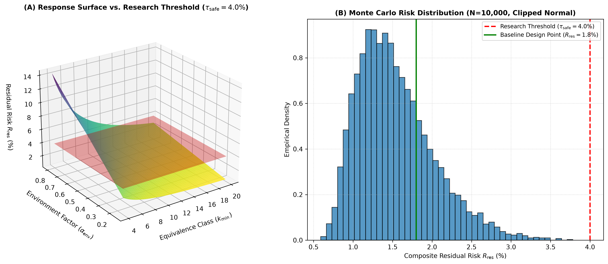

<div align="center">

# Scenario-Risk Safe Harbor Simulation & Sensitivity Analysis
### Open-Source Reproducibility Suite for Academic Research

[](https://github.com/jhuang-edu/icbar-2026-safe-harbor-simulation/releases/tag/v1.1.0)
[](https://www.ais.cn/attendees/index/2ER6F3)
[](#)
[](https://www.python.org/)
[](LICENSE)
[](https://creativecommons.org/licenses/by/4.0/)

<p align="center">
  <a href="#english">English</a> •
  <a href="#中文说明">中文说明</a> •
  <a href="#日本語案内">日本語案内</a> •
  <a href="#version-history">Version History</a> •
  <a href="REFERENCES.md"><strong>📚 Reference List / 参考文献清单</strong></a>
</p>

---

</div>

<a name="version-history"></a>
## 🚀 Version History & Academic Release Notes

This repository strictly adheres to reproducible research principles. Versions correspond directly to manuscript iterations:

| Version | Status | Key Characteristics & Methodology |
|:---:|:---:|:---|
| [**v1.0.0**](https://github.com/jhuang-edu/icbar-2026-safe-harbor-simulation/releases/tag/v1.0.0) | Archived Snapshot | **Official reproducible baseline snapshot for Paper v2 (submitted).** Matches all numerical and graphical results in the initial revision manuscript. |
| [**v1.1.0**](https://github.com/jhuang-edu/icbar-2026-safe-harbor-simulation/releases/tag/v1.1.0) | Current Release | **Methodological hardening & decoupled criteria release:**<br>1. **IEEE 754 Precision Fix**: Implemented exact decimal evaluation for $\alpha \times \gamma \le \tau \times k$. In the 315-point grid, only **one single edge-case** (`k=5, alpha=0.20, gamma=1.00`) changes evaluation from `False` to `True` (exactly equals 4.00%).<br>2. **Decoupled Governance Evaluation**: Disentangled pure numeric threshold (`meets_risk_threshold`) from statutory triad criteria (`framework_requirements_status`). For example, $k=5$ yields $3.60\% \le 4.0\%$ (numeric pass), but fails statutory criteria because $k < 10$.<br>3. **Reproducible Stress Testing**: Introduced environmental degradation and organizational erosion stress scenarios with analytical safety margins $\alpha_{\mathrm{crit}} = \frac{\tau \cdot k}{\gamma}$.<br>4. **Statistical Rigor**: Explicitly documented sampling distribution as Clipped Normal with optional Truncated Normal support; updated visualizations to reflect research-defined thresholds. |

---

<a name="english"></a>
## English

### 1. Research Overview & Methodological Scope
- **Paper Title**: *Scenario-Risk Safe Harbor for Secondary Health Data Governance and AI Training under China's Personal Information Protection Law*
- **Current Status**: Under Revision / Peer Review (Target Venue: ICBAR 2026, proceedings scheduled with IOS Press *FAIA*).
- **Core Focus**: Addressing the operational challenges of sensitive personal data "separate consent" requirements under Articles 28 and 29 of China's PIPL for retrospective clinical research and medical AI training, proposing a three-element scenario-risk safe harbor framework.
- **Methodological Hypotheses**: Baseline factors ($\alpha_{\mathrm{env}}=0.25$, $\gamma_{\mathrm{org}}=0.72$) and the safe harbor threshold ($\tau_{\mathrm{safe}}=0.04$) represent research-defined prior hypotheses for conditional probability risk modeling, subject to empirical calibration on target hospital cohorts.
- **Academic Contact**: `3588@duck.com` (for research questions and simulation inquiries).

### 2. Architecture & Governance Diagrams

<div align="center">

#### Figure 1: Three-Element Safe Harbor & PIA-IRB Co-Governance Architecture


<br><br>

#### Figure 2: Four-Phase Governance Evaluation & Dynamic Evolution


</div>

### 3. Theoretical Risk Formulation (Equation 1)
Under a defense-in-depth architecture, re-identification requires the conjunctive occurrence of three sequential failure events: (i) organizational deterrence failure $P(E_{\mathrm{org}}) = \gamma_{\mathrm{org}}$, (ii) environment containment failure $P(E_{\mathrm{env}} \mid E_{\mathrm{org}}) = \alpha_{\mathrm{env}}$, and (iii) quasi-identifier linkage $P(E_{\mathrm{ID}} \mid E_{\mathrm{env}}, E_{\mathrm{org}}) = 1 / k_{\min}$. By the chain rule of conditional probability:

$$R_{\mathrm{res}} = \left(\frac{1}{k_{\min}}\right) \cdot \alpha_{\mathrm{env}} \cdot \gamma_{\mathrm{org}} \le \tau_{\mathrm{safe}}\ (0.04)$$

Where:
- $k_{\min} \ge 10$: Quasi-identifier equivalence class minimum size ($p_{\mathrm{link}} = 1 / k_{\min}$);
- $\alpha_{\mathrm{env}} = 0.25$: Zero-egress federated computation sandbox with DP-SGD noise ($\varepsilon \le 2.0$);
- $\gamma_{\mathrm{org}} = 0.72$: Binding anti-reidentification covenants and immutable audit logging.
- $\tau_{\mathrm{safe}} = 0.04$ (4.0%): Stricter than EMA Policy 0070 (0.09) and conservative for PIPL due care presumption. Baseline risk yields $R_{\mathrm{res}} = 0.10 \times 0.25 \times 0.72 = 1.80\% \le 4.0\%$.

### 4. Decoupled Operational Scenarios & Stress Testing

| Scenario ID | Operational Scenario Description | $k_{\min}$ | $\alpha_{\mathrm{env}}$ | $\gamma_{\mathrm{org}}$ | $R_{\mathrm{res}}$ | Numeric Pass ($\le 4\%$) | Framework Status ($k \ge 10$ & Triad) |
|:---:|:---|:---:|:---:|:---:|:---:|:---:|:---:|
| **S1** | **Baseline Full Safe Harbor** | **10** | **0.25** | **0.72** | **1.80%** | **True** | **passed** |
| S2 | Element 1 Alone (Raw export, no covenant) | 10 | 1.00 | 1.00 | 10.00% | False | failed |
| S3 | Elements 1 & 2 (Sandbox, no covenant) | 10 | 0.25 | 1.00 | 2.50% | True | failed |
| S4 | Environmental Degradation (+120% exposure) | 10 | 0.55 | 0.72 | 3.96% | True | passed |
| S5 | Critical Environment Breakdown ($\alpha=0.60$) | 10 | 0.60 | 0.72 | 4.32% | False | passed |
| S6 | Rare Disease Cohort (Small class $k=5$) | 5 | 0.25 | 0.72 | 3.60% | True | **failed ($k < 10$)** |
| S7 | Boundary Edge Case ($k=5, \alpha=0.20, \gamma=1.0$) | 5 | 0.20 | 1.00 | 4.00% | **True (Exact 4%)** | **failed ($k < 10$)** |
| S8 | Sub-Threshold Rare Cohort ($k=4$) | 4 | 0.25 | 0.72 | 4.50% | False | failed |
| S9 | Ultra-Secure Sandbox ($k=15, \varepsilon=1.0$) | 15 | 0.15 | 0.72 | 0.72% | True | passed |

#### Stress Testing & Distance-to-Failure Analysis
The analytical critical exposure threshold is defined by $\alpha_{\mathrm{crit}} = \frac{\tau_{\mathrm{safe}} \cdot k_{\min}}{\gamma_{\mathrm{org}}}$:
- **Moderate Exposure** ($\alpha=0.50, \gamma=0.72$): $R_{\mathrm{res}} = 3.60\%$, $\alpha_{\mathrm{crit}} = 0.5556$, Safety Margin = $+0.0556$ (Safe).
- **Organizational Erosion** ($\alpha=0.25, \gamma=0.85$): $R_{\mathrm{res}} = 2.12\%$, $\alpha_{\mathrm{crit}} = 0.4706$, Safety Margin = $+0.2206$ (Safe).
- **Dual Stress Breakdown** ($\alpha=0.50, \gamma=0.85$): $R_{\mathrm{res}} = 4.25\%$, $\alpha_{\mathrm{crit}} = 0.4706$, Safety Margin = $-0.0294$ (**Breached**).
- **Adversarial Extreme** ($\alpha=0.75, \gamma=1.00$): $R_{\mathrm{res}} = 7.50\%$, $\alpha_{\mathrm{crit}} = 0.4000$, Safety Margin = $-0.3500$ (**Breached**).

<div align="center">

#### Figure 3: Parameter Sensitivity Surface & Monte Carlo Distribution


</div>

### 5. Quick Start & Verification
```bash
# Clone the repository
git clone https://github.com/jhuang-edu/icbar-2026-safe-harbor-simulation.git
cd icbar-2026-safe-harbor-simulation

# Install requirements
pip install -r requirements.txt

# Run automated regression & assertion test suite
python test_sensitivity.py

# Run full parameter sensitivity evaluation, stress testing & Monte Carlo simulation
python sensitivity_analysis.py
```

---

<a name="中文说明"></a>
## 中文说明

### 1. 论文与研究背景
- **论文题目**：《个人信息保护法》下医疗健康数据二次治理与AI训练的场景风险安全港研究
- **当前状态**：审稿返修中（拟投递 ICBAR 2026，拟收录于 IOS Press *FAIA* 论文集）。
- **学术定位**：针对我国《个人信息保护法》第 28、29 条敏感个人信息“单独同意”在回顾性医学科研与医疗大模型训练中的实务困境，构建基于国标 GB/T 39725-2020（附录 G）、受控联邦差分隐私沙箱与法律级联承诺的三要件场景风险安全港。
- **先验假设声明**：基准系数（$\alpha_{\mathrm{env}}=0.25, \gamma_{\mathrm{org}}=0.72$）与门控阈值（$\tau_{\mathrm{safe}}=0.04$）属于探索性数理推导设定的研究先验假设，输出判定定义为“模型阈值判定”，非现行成文法直接法定标准。
- **联系邮箱**：`3588@duck.com`（学术交流、仿真代码复现咨询）。

### 2. 双轨解耦治理判定机制（v1.1.0 核心更新）
安全港不是单一数值计算器，而是“法定三要件 + 残余风险门槛”的双轨闭环：
1. **纯数值风险门槛（`meets_risk_threshold`）**：严格十进制评估 $\alpha \times \gamma \le \tau \times k$。消除浮点截断误差，恰好 $4.00\%$ 时判定达标；
2. **要件合规状态（`framework_requirements_status`）**：严格依凭表 2 准入要件。当小等价类样本（如罕见病 $k=5$）算得 $3.60\% \le 4.0\%$ 时，虽然数值通过，但要件状态明确返回 `failed`（因其违背了 $k_{\min} \ge 10$ 的法定最低泛化要求）。

---

<a name="日本語案内"></a>
## 日本語案内

### 1. 論文情報と研究概要
- **論文題目**: 中国個人情報保護法下における医療健康データ二次利用およびAI訓練のためのシナリオリスク・セーフハーバー研究
- **現在のステータス**: 査読改訂中（ICBAR 2026 投稿予定、IOS Press *FAIA* 収録予定）。
- **目的**: プライバシー保護工学と法解釈論を融合させた「シナリオリスク・セーフハーバー」の数理解析シミュレーションです。
- **連絡先**: `3588@duck.com`

---

## Repository Structure & Reproducibility Assets

```
icbar-2026-safe-harbor-simulation/
├── README.md                          # Trilingual comprehensive documentation (EN / ZH / JA)
├── REFERENCES.md                      # Complete annotated bibliography (22 regulatory & academic works)
├── LICENSE                            # MIT License for source code
├── requirements.txt                   # Minimal Python runtime dependencies (numpy, matplotlib)
├── sensitivity_analysis.py            # Executable parameter grid sweep, stress testing & Monte Carlo
├── test_sensitivity.py                # Automated regression & assertion test suite (5 assertions)
├── data/
│   ├── sensitivity_grid.csv           # 315-point multi-parameter grid with decoupled evaluation
│   └── monte_carlo_results.csv        # 10,000-draw stochastic simulation logs
└── figures/
    ├── figure1_safe_harbor_architecture.png   # Tripartite safe harbor architecture & PIA-IRB co-governance
    ├── figure2_governance_evaluation.png      # Four-phase governance dynamic evolution
    └── figure_sensitivity_surface.png         # Refined 3D response surface and density chart (Research Threshold)
```

## Citation, License & Contact
- Code: [MIT License](LICENSE)
- Data and Documentation: [Creative Commons Attribution 4.0 International (CC BY 4.0)](https://creativecommons.org/licenses/by/4.0/)
- Citation: Please cite as "Simulation and Sensitivity Suite for Scenario-Risk Safe Harbor (Under Review)".
- Research Inquiries: `3588@duck.com`
